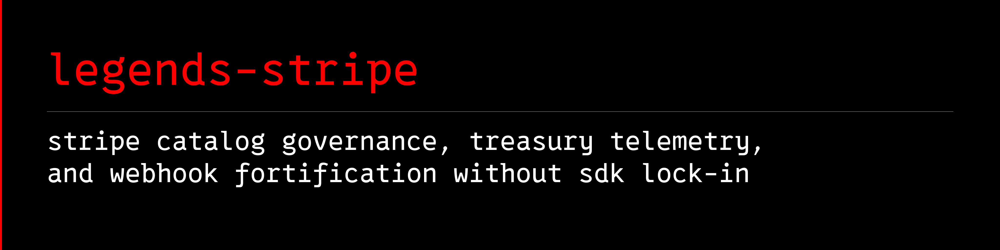
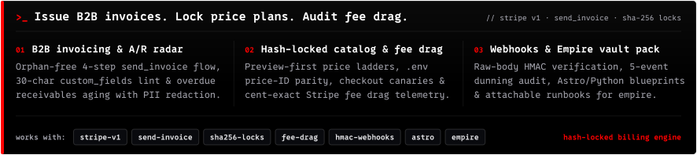
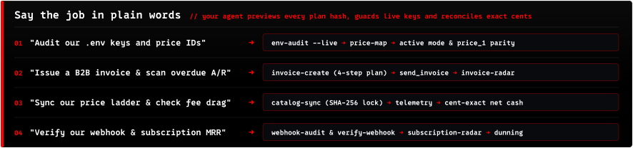
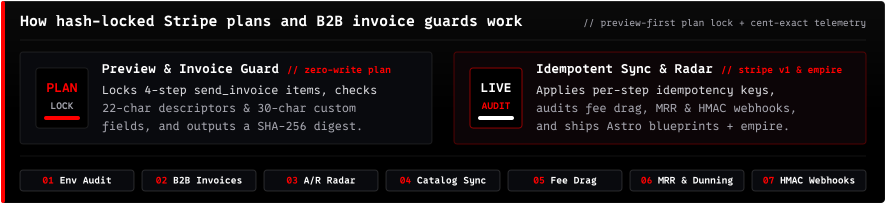
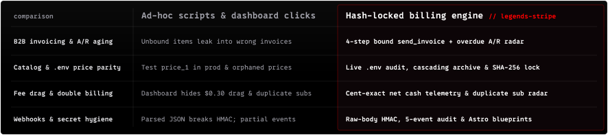

<a name="banner"></a>
<a name="legends-stripe"></a>

# 

[](https://github.com/avalonreset/legends-stripe/releases/latest)
[](https://github.com/avalonreset/legends-stripe/actions/workflows/checks.yml)
[](#reference)
[](docs/AGENT-RECIPE.md)
[](LICENSE)

**Zero-dependency Stripe billing, orphan-free B2B Hosted Invoicing (`send_invoice`), overdue receivables radar, hash-locked catalog and checkout CLI (`legends-stripe`) for coding agents: audit `.env` test/live price-ID parity, issue 4-step bound B2B invoices with 30-char `custom_fields` validation, sync price ladders behind SHA-256 plan locks, reconcile cent-exact Stripe fee drag and net retained cash, verify raw-body HMAC webhooks, and attach source-cited billing runbooks to [`legends-empire`](https://github.com/avalonreset/legends-empire).**


```text
Install or update legends-stripe via cto-legends (https://github.com/avalonreset/cto-legends): run `cto-legends install legends-stripe --apply`, then `cto-legends handoff legends-stripe` and follow the returned JSON recipe to verify `legends-stripe doctor`.
```



## Why `legends-stripe` exists

Developers and founders shipping on Astro, Next.js, or Python hit the same high-cost Stripe failure modes when relying on ad-hoc scripts or dashboard clicks:

1. **Orphaned B2B invoice items and unmonitored overdue receivables:** In Stripe's API, creating an `InvoiceItem` without explicitly binding `invoice=draft.id` leaves pending items floating on the customer record to leak into the next subscription renewal, while `custom_fields` over 30 characters fail at runtime and Customer-Scheduled Invoice Payments fire zero scheduling webhook events.
2. **Test vs. Live `.env` price-ID drift and silent catalog traps:** An `sk_live_...` secret key gets paired with a `pk_test_...` publishable key or a `price_1...` ID from the wrong mode; product descriptions over 500 characters truncate; statement descriptors over 22 characters or containing `< > \ ' " *` get rejected; and archiving a Product leaves its child Prices `active: true` as orphans.
3. **Hidden Stripe fee drag and fragile webhook signature handlers:** Standard dashboard charts celebrate gross volume while `$0.30` fixed transaction fees on `$10` charges, international card surcharges, and `0.7%` Stripe Billing usage fees quietly eat 4% to 7.4% of revenue. Meanwhile, web middleware parses JSON before verifying `Stripe-Signature` (breaking raw-body HMAC-SHA256 digests) or subscribes only to `checkout.session.completed` while missing the renewal, dunning, and cancellation events required for a clean subscription lifecycle.

`legends-stripe` solves all of these with a **zero-dependency Python 3.11+ standard-library CLI** (`urllib.request`, `hmac`, `hashlib`) that pairs naturally with [`legends-astro`](https://github.com/avalonreset/legends-astro), [`legends-gohighlevel`](https://github.com/avalonreset/legends-gohighlevel), and [`legends-empire`](https://github.com/avalonreset/legends-empire). Every write operation (`invoice-create`, `invoice-void`, `catalog-sync`, `product-upsert`, `webhook-upsert`, and `checkout-canary`) defaults to a read-only preview and locks execution behind a deterministic SHA-256 `plan_sha256` hash (`--apply --confirm-plan <sha256>`, plus `--live` for live keys).

## Ask in plain english

Once [`cto-legends`](https://github.com/avalonreset/cto-legends) is installed, you ask your coding agent in plain english. It previews the SHA-256 plan hash first, enforces test/live key and idempotency guards, and reconciles balances to the exact cent:



## Architecture: hash-locked Stripe plans and B2B invoice guards



### 1. Orphan-free B2B Hosted Invoicing (`send_invoice`) and overdue A/R radar

B2B wire, ACH, and corporate card settlements require strict separation from automated subscription billing:

- **4-step bound B2B invoice lifecycle (`invoice-create` & `invoice-void`):** Enforces `Customer -> Draft send_invoice -> Bound InvoiceItem (invoice=draft.id) -> Finalize + Readback` locked by preview-first `plan_sha256` confirmation and per-step idempotency keys. Validates `custom_fields` offline (maximum 4 fields, 30 printable characters per `name` and `value`), 500-character descriptions/footers, and `days_until_due` (`1..365`), returning the finalized `hosted_invoice_url` and `invoice_pdf`.
- **Overdue receivables aging radar (`invoice-radar`):** Separates standalone B2B `send_invoice` receivables from subscription invoices, computes overdue days and open/draft totals by currency, redacts customer PII (`--redact-pii`), and surfaces Customer-Scheduled Invoice Payments governance notes.

### 2. Complete CLI and Python capability surface

Every workflow in `legends-stripe` separates offline validation and zero-write plan previews from hash-confirmed execution:

| Surface | `legends-stripe` Subcommands / Python API | What It Does |
| :--- | :--- | :--- |
| **Environment & Price-ID Audit** | `env-audit`, `price-map` / `audit_env_file()`, `build_price_map()` | Cross-checks `.env` `STRIPE_SECRET_KEY`, `STRIPE_PUBLISHABLE_KEY`, `price_1...`, and `prod_...` tokens against Test or Live Stripe mode and exports `.env`, JSON, or TypeScript `as const` lookup maps. |
| **B2B Hosted Invoicing & A/R Radar** | `invoice-radar`, `invoice-create`, `invoice-void` / `scan_invoice_radar()`, `create_b2b_invoice()`, `void_b2b_invoice()` | Scans open B2B `send_invoice` receivables and overdue aging, issues orphan-free 4-step Hosted Invoices (`hosted_invoice_url`, `invoice_pdf`), and voids open invoices with SHA-256 plan confirmation. |
| **Catalog Lint & Price Ladders** | `catalog-audit`, `catalog-export`, `product-upsert`, `ladder-plan`, `catalog-diff`, `catalog-sync` / `audit_catalog()` | Flags 500-char description truncation, 22-char statement descriptor violations, and orphaned active Prices; cascades child-price deactivation on `--inactive`; and syncs price ladders with `plan_sha256` locks. |
| **Fee Drag & Net Cash Telemetry** | `telemetry` / `build_treasury_telemetry()`, `render_telemetry_markdown()` | Reconciles `/v1/balance`, `/v1/balance_transactions`, and `/v1/charges` (filtering out zero-fee 3DS card verifications) to compute Gross Revenue, Stripe Drag fee percentage, Refunds, Disputes, and Net Retained Cash to the cent. |
| **Subscription MRR & Checkout Canary** | `subscription-radar`, `checkout-canary` / `scan_subscription_radar()`, `run_checkout_canary()` | Computes active MRR/ARR, `past_due` dunning recovery queues, `cancel_at_period_end` churn, and duplicate-billed customer alerts, and runs preview-first disposable Checkout Session canaries. |
| **Webhooks, Domains & Blueprints** | `verify-webhook`, `sign-webhook`, `webhook-probe`, `webhook-audit`, `webhook-upsert`, `custom-domain-check`, `blueprint` | Constant-time `Stripe-Signature` (`t=...,v1=...`) HMAC-SHA256 verification (refusing raw `whsec_` secrets on CLI `argv`), 5-event Soft-Land Subscription Lifecycle audits, SSRF-hardened endpoint and custom-domain probes, and drop-in Astro/Python blueprints. |

### 3. Drop-in server blueprints and `legends-empire` knowledge vault

- **5 production server blueprints (`legends-stripe blueprint`):** Ships ready-to-drop TypeScript and Python endpoints: `astro-webhook` (raw-body HMAC verification), `astro-checkout` (Checkout Session creation), `astro-portal` (same-origin Customer Billing Portal with `sk_`/`rk_` validation), `astro-b2b-invoice` (timing-safe token-gated B2B Hosted Invoice issuance), and `python-webhook` (multi-`v1` secret rotation support).
- **Attachable [`legends-empire`](https://github.com/avalonreset/legends-empire) knowledge pack (`knowledge/stripe/pack.json`):** Ships a `legends.knowledge-pack/v1` operational library and [wiki/index.md](wiki/index.md) covering Test/Live mode parity, price ladder design, B2B Hosted Invoicing settlement, fee drag reduction, soft-land webhook lifecycles, and private operation receipt templates.

## Ad-hoc Stripe scripts vs `legends-stripe`



## Quick start

```sh
# 1. Verify offline runtime health, audit .env price IDs, and export TypeScript price maps
legends-stripe doctor
legends-stripe env-audit --target-env .env --live
legends-stripe price-map --format ts

# 2. Scan B2B receivables and preview/issue an orphan-free 4-step Hosted Invoice
legends-stripe invoice-radar --redact-pii
legends-stripe invoice-create --customer-email billing@acme.example --company-name "Acme Corp" \
  --amount-cents 102400 --title "Architecture Advisory Sprint" \
  --invoice-number-ref "INV-2026-11-001" --custom-field "Client VAT / Tax ID=DE123456789"

# 3. Reconcile cent-exact Stripe fee drag, net retained cash, and subscription MRR/dunning
legends-stripe telemetry --redact-pii
legends-stripe subscription-radar --redact-pii

# 4. Lint products/prices, plan a price ladder, and preview a disposable Checkout canary
legends-stripe catalog-audit
legends-stripe ladder-plan --prefix "SaaS Pro" --amounts "19,49,99" --intervals "month,year" \
  --statement-descriptor "SAAS PRO" --output spec.json
legends-stripe catalog-diff --spec spec.json
legends-stripe checkout-canary --price-id price_1Example123

# 5. Audit 5-event subscription webhooks, verify raw-body HMAC signatures, and export blueprints
legends-stripe webhook-audit --expected-url https://app.example.com/api/stripe/webhook
legends-stripe verify-webhook --payload @event.json --signature "t=1700000000,v1=..." --secret @webhook-secret.txt
legends-stripe blueprint --list
legends-stripe blueprint --name astro-b2b-invoice --raw
```

## Reference

<details>
<summary><strong>Knowledge vault, billing runbooks, and <code>legends-empire</code> integration</strong></summary>

Start at [wiki/index.md](wiki/index.md) or attach the versioned knowledge pack at [knowledge/stripe/pack.json](knowledge/stripe/pack.json) (`legends.knowledge-pack/v1`). See [docs/KNOWLEDGE-PACK.md](docs/KNOWLEDGE-PACK.md) for attachment instructions.

- **Operational runbooks:** [Overview](wiki/overview.md), [Authentication & modes](wiki/authentication-and-modes.md), [Catalog & price ladders](wiki/catalog-and-price-ladders.md), [Checkout & custom domains](wiki/checkout-and-custom-domains.md), [Invoicing & B2B settlement](wiki/invoicing-and-b2b-settlement.md), [Subscriptions & dunning](wiki/subscriptions-and-dunning.md), [Treasury & Stripe drag](wiki/treasury-and-stripe-drag.md), [Webhooks & soft-land lifecycle](wiki/webhooks-and-soft-land-lifecycle.md), [Troubleshooting](wiki/troubleshooting.md), and [Primary sources & citations](references/sources.md).
- **Private operating templates:** Use [templates/private-operation-receipt.md](templates/private-operation-receipt.md), [templates/treasury-telemetry.md](templates/treasury-telemetry.md), and [templates/webhook-fortification-receipt.md](templates/webhook-fortification-receipt.md) to archive sanitized billing and telemetry receipts in your private vault.

</details>

<details>
<summary><strong>Agent setup (via <code>cto-legends</code>) and standalone installation</strong></summary>

### Agent setup (via `cto-legends`)

Part of the [cto-legends](https://github.com/avalonreset/cto-legends) ecosystem. `cto-legends` is the only registered skill; this repository vendors a pinned copy at [skills/cto-legends/SKILL.md](skills/cto-legends/SKILL.md). The product, repository, Python distribution, and catalog ID are `legends-stripe`.

Run `cto-legends handoff legends-stripe` and follow the module recipe ([docs/AGENT-RECIPE.md](docs/AGENT-RECIPE.md)). Do not register this module as its own standalone skill. For a standalone local checkout:

```sh
git clone https://github.com/avalonreset/legends-stripe.git
cd legends-stripe
python -m pip install -e .
legends-stripe doctor
legends-stripe resources
```

Secret keys (`sk_live_`, `sk_test_`, `rk_`) and webhook secrets (`whsec_`) are scrubbed from CLI outputs, error messages, and Markdown reports. Raw `whsec_` literals are refused on CLI `argv` (use `STRIPE_WEBHOOK_SECRET`, `--secret @<file>`, `--secret-file <file>`, or `--secret-stdin`).

</details>

<details>
<summary><strong>Repository layout, verification, and safety boundaries</strong></summary>

```text
Operator / Agent
  -> legends-stripe CLI (env-audit, invoice-create, catalog-sync, telemetry, subscription-radar, webhook-audit)
  -> Offline validator & preview builder (22-char descriptors, 30-char custom_fields, SHA-256 plan_sha256)
  -> Explicit confirmation (--apply --confirm-plan <sha256> [--live]) + per-step Idempotency-Key
  -> Stripe API v1 execution (ProxyHandler({}), SSRF/CGNAT refusal, pinned-IP TLS) + immediate readback
```

- `legends_stripe/`: Zero-dependency Python 3.11+ CLI (`cli.py`), Stripe API v1 form encoder and SSRF-hardened client (`api.py`), B2B invoicing engine (`invoices.py`), catalog & ladder sync (`catalog.py`), `.env` auditor (`env_tools.py`), treasury telemetry (`telemetry.py`), subscription radar (`subscriptions.py`), webhook verifier (`webhooks.py`), and server blueprints (`blueprints.py`).
- `docs/`: [Agent operating recipe](docs/AGENT-RECIPE.md), [Knowledge pack guide](docs/KNOWLEDGE-PACK.md), and [Release procedure](docs/RELEASE.md).

```sh
python -m unittest discover -s tests -v
python scripts/check_release.py
```

`legends-stripe` never handles raw credit card PAN numbers or PCI-DSS cardholder data, never mutates Live Mode without `--apply --confirm-plan <plan_sha256> --live`, and never follows HTTP redirects with `Authorization` headers attached or probes loopback, private RFC1918, or CGNAT (`100.64.0.0/10`) addresses.

</details>

## Contributing, security, and license

See [CONTRIBUTING.md](CONTRIBUTING.md), [SUPPORT.md](SUPPORT.md), [CODE_OF_CONDUCT.md](CODE_OF_CONDUCT.md), [SECURITY.md](SECURITY.md), and [CHANGELOG.md](CHANGELOG.md).

MIT License. See [LICENSE](LICENSE), [NOTICE.md](NOTICE.md), and [THIRD_PARTY_NOTICES.md](THIRD_PARTY_NOTICES.md).

[](https://github.com/avalonreset/cto-legends/issues/new?title=Message%20for%20Avalon%20Reset&labels=message)

<p align="center"><a href="https://github.com/stars/avalonreset/lists/cto-legends"></a></p>

**Specification & benchmarks on cto-legends.com:**
- **Module specification & architecture matrix:** [cto-legends.com/modules/legends-stripe](https://cto-legends.com/modules/legends-stripe)
- **Related engineering dispatches:** [Fractional CTO Advisory: Technical Due Diligence Guide](https://cto-legends.com/blog?post=fractional-cto-technical-due-diligence-guide) · [How to Build AI Agents: Production CLI & MCP Routing](https://cto-legends.com/blog?post=how-to-build-ai-agents-cli-mcp-routing) · [Claude Code Skills: MCP vs CLI Workflow Architecture](https://cto-legends.com/blog?post=claude-code-skills-mcp-vs-cli-workflow)
- **Ecosystem hub:** [cto-legends.com/home](https://cto-legends.com/home)
