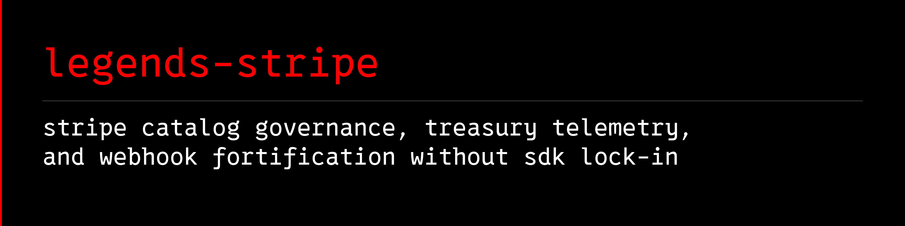

<a name="banner"></a>
<a name="legends-stripe"></a>

# 

[](https://github.com/avalonreset/legends-stripe/releases/latest)
[](https://github.com/avalonreset/legends-stripe/actions/workflows/checks.yml)
[](LICENSE)

**Stripe CLI, Stripe Checkout, Stripe Billing, webhook signature verification, and treasury fee telemetry from Python or your terminal.**
`legends-stripe` connects scripts, applications, and coding agents to the Stripe API (`v1`) with offline request previews, SHA-256 mutation locks, `.env` price-ID drift detection, Stripe fee calculator telemetry, subscription dunning diagnostics, and drop-in Astro, Node, and Python server blueprints.

Python 3.11+ | Windows, Linux, macOS | Zero runtime dependencies | MIT licensed

[Quick start](#quick-start) | [What you can build](#what-you-can-build) | [Operating recipe](docs/AGENT-RECIPE.md) | [Knowledge vault](wiki/index.md) | [Agent setup](#agent-setup-via-cto-legends) | [Releases](https://github.com/avalonreset/legends-stripe/releases)

## Agent setup (via `cto-legends`)

Part of the [cto-legends](https://github.com/avalonreset/cto-legends) ecosystem. `cto-legends` is the only registered skill; this repository vendors a pinned copy at [skills/cto-legends/SKILL.md](skills/cto-legends/SKILL.md).

The product, repository, Python distribution, and catalog ID are `legends-stripe`.

Install with `cto-legends install legends-stripe`, then follow the module recipe the router loads ([docs/AGENT-RECIPE.md](docs/AGENT-RECIPE.md)). Do not register this module as its own standalone skill.

## What you can build

| Workflow | Included CLI / Python interface | What you get |
| --- | --- | --- |
| Environment & Stripe Price ID audit | `legends-stripe env-audit` / `audit_env_against_stripe()` | Cross-checks `.env` `STRIPE_SECRET_KEY`, `STRIPE_PUBLISHABLE_KEY`, `price_1...`, and `prod_...` tokens against live or test Stripe mode |
| Price map codegen | `legends-stripe price-map` / `export_price_map()` | Exports active Stripe Products and Prices as `.env`, JSON, or TypeScript `as const` lookup maps |
| Stripe fee calculator & treasury telemetry | `legends-stripe telemetry` / `compute_treasury_telemetry()` | Cent-exact Gross Revenue, Stripe Drag fee percentage, Refunds, Disputes, Net Retained Cash, and 12-month projections |
| Product catalog lint | `legends-stripe catalog-audit` / `audit_catalog()` | Flags 500-char description truncation, 22-char statement descriptor violations, and orphaned active Prices |
| Declarative price ladder sync | `legends-stripe ladder-plan`, `catalog-diff`, `catalog-sync` | Generates exponential or custom price ladders, diffs against Stripe, and syncs with preview-first SHA-256 plan hashes |
| Stripe Billing & subscription radar | `legends-stripe subscription-audit` / `audit_subscriptions()` | Computes active MRR/ARR, past-due dunning recovery queues, cancel-at-period-end churn, and duplicate-billed customer alerts |
| Stripe Checkout canary | `legends-stripe checkout-smoke` / `run_checkout_canary()` | Creates and immediately expires a disposable zero-charge Stripe Checkout Session to prove end-to-end Price readiness |
| Stripe Webhook signature verification | `legends-stripe verify-webhook`, `sign-webhook`, `webhook-probe` | Constant-time `Stripe-Signature` (`t=...,v1=...`) HMAC-SHA256 verification, test header signing, and live endpoint probing |
| Webhook lifecycle audit & bootstrap | `legends-stripe webhook-audit`, `webhook-bootstrap` | Audits endpoints against the 5-event Soft-Land Subscription Lifecycle and registers missing webhooks with preview-first locking |
| Custom payment domain check | `legends-stripe custom-domain-check` / `check_custom_domain()` | DNS CNAME and HTTPS TLS readiness probe for white-labeled Stripe payment domains |
| Astro Stripe & Python blueprints | `legends-stripe blueprint` / `list_blueprints()` | Production-ready `astro-webhook`, `astro-checkout`, `astro-portal` (Stripe Customer Portal), and `python-webhook` templates |

## Why `legends-stripe` exists

Developers and founders building on Astro, Next.js, or Python hit the same high-cost Stripe failure modes repeatedly:

- **Test vs. Live `.env` and Stripe Price ID Drift**: An `sk_live_...` secret key gets paired with a `pk_test_...` publishable key or a `price_1...` ID from the wrong mode, breaking production Stripe Checkout.
- **Silent Catalog Traps**: Product descriptions over 500 characters fail or truncate; statement descriptors over 22 characters or containing `< > \ ' " *` get rejected; archiving a Product leaves its child Prices `active: true` as orphans.
- **Hidden Stripe Drag**: Gross volume looks healthy while `\$0.30` fixed transaction fees on `\$10` wallet auto-recharges, international card surcharges, and `0.7%` Stripe Billing usage fees quietly eat 4% to 7.4% of revenue.
- **Fragile Stripe Webhook Endpoints**: Frameworks parse JSON before `Stripe-Signature` verification (breaking HMAC-SHA256 digests), or endpoints subscribe to `checkout.session.completed` while missing the renewal, dunning, and cancellation events required for a clean Soft-Land Subscription Lifecycle.

`legends-stripe` solves all of these with a **zero-dependency Python standard-library CLI** (`urllib.request`, `hmac`, `hashlib`), preview-first SHA-256 plan locking, SSRF and symlink hardened file I/O, and an attachable `legends-empire` knowledge pack.

## Install

```bash
python -m pip install "https://github.com/avalonreset/legends-stripe/releases/download/v0.1.0/legends_stripe-0.1.0-py3-none-any.whl"
legends-stripe --version
legends-stripe doctor
```

For local editable development:

```bash
git clone https://github.com/avalonreset/legends-stripe.git
cd legends-stripe
python -m pip install -e .
legends-stripe doctor
legends-stripe resources
```

## Quick start

### 1. Audit a project `.env` and export Stripe Price IDs (`env-audit` and `price-map`)

```bash
legends-stripe env-audit --target-env .env --live
legends-stripe price-map --format dotenv
legends-stripe price-map --format ts
```

### 2. Run Stripe fee calculator and treasury reconciliation (`telemetry`)

```bash
legends-stripe telemetry --redact-pii
legends-stripe telemetry --markdown --redact-pii --output treasury-report.md
```

### 3. Audit, plan, and sync product catalogs (`catalog-audit`, `ladder-plan`, `catalog-sync`)

```bash
legends-stripe catalog-audit
legends-stripe ladder-plan --prefix "SaaS Pro" --amounts "19,49,99" --intervals "month,year" --statement-descriptor "SAAS PRO" --output spec.json
legends-stripe catalog-diff --spec spec.json
legends-stripe catalog-sync --spec spec.json
```

### 4. Audit Stripe Billing subscriptions and run a Stripe Checkout canary (`subscription-audit`, `checkout-smoke`)

```bash
legends-stripe subscription-audit --redact-pii
legends-stripe checkout-smoke --price-id price_1Example123
```

### 5. Fortify Stripe Webhook signature verification and custom domains (`webhook-audit`, `webhook-probe`, `verify-webhook`)

```bash
legends-stripe webhook-audit --expected-url https://app.example.com/api/stripe/webhook
legends-stripe webhook-probe --url https://app.example.com/api/stripe/webhook
legends-stripe verify-webhook --payload-file event.json --signature-header "t=1700000000,v1=..."
legends-stripe custom-domain-check --hostname pay.example.com
```

### 6. Export Astro Stripe Checkout, Customer Portal, and Webhook blueprints (`blueprint`)

```bash
legends-stripe blueprint --list
legends-stripe blueprint --name astro-webhook --raw
legends-stripe blueprint --name astro-checkout --raw
legends-stripe blueprint --name astro-portal --raw
```

## FAQ

### How does `legends-stripe` relate to the official Stripe CLI and `stripe-python` SDK?
`legends-stripe` is a lightweight, zero-dependency operational governance and diagnostic CLI built on the Python 3.11+ standard library. While the official Stripe CLI focuses on local webhook forwarding and generic resource calls, `legends-stripe` provides opinionated guardrails: `.env` test/live price-ID cross-checking, preview-first SHA-256 catalog sync, cent-exact Stripe fee drag telemetry, double-billing radar, and ready-to-drop Astro and Python webhook blueprints.

### Can `legends-stripe` mutate my Live Mode Stripe account accidentally?
No. All write commands (`catalog-sync`, `webhook-bootstrap`, and `checkout-smoke` in Live Mode) run in **preview mode by default** and compute a deterministic SHA-256 `plan_hash`. No Live Mode mutation occurs unless you explicitly pass `--execute --confirm-plan <plan_hash>`.

### How does `legends-stripe` protect API keys and customer PII?
Secret keys (`sk_live_`, `sk_test_`, `rk_`) and webhook secrets (`whsec_`) are scrubbed from CLI outputs, error messages, and Markdown reports. Passing `--redact-pii` masks customer emails and identifiers across all telemetry and subscription audits.

## Documentation and Knowledge Vault

- [Agent Operating Recipe](docs/AGENT-RECIPE.md)
- [Knowledge Pack & Empire Attachment Guide](docs/KNOWLEDGE-PACK.md)
- [Release & Verification Procedure](docs/RELEASE.md)
- [Stripe Knowledge Vault Index](wiki/index.md)
- [Primary Sources & Citations](references/sources.md)
- [Security Policy](SECURITY.md)
- [Support Guide](SUPPORT.md)
- [Contributing Guide](CONTRIBUTING.md)
- [Changelog](CHANGELOG.md)

## License

MIT License. See [LICENSE](LICENSE) and [NOTICE.md](NOTICE.md).
