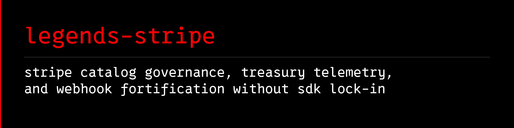

# legends-stripe



Portable Python 3.11+ CLI, attachable operational knowledge vault, and drop-in server blueprints for operating **Stripe** payment infrastructure: catalog governance, `.env` price-ID auditing, exponential price ladders, cent-level treasury telemetry, subscription dunning and duplicate-billing radar, and webhook fortification.

## Why `legends-stripe` Exists

Developers and founders building on Astro, Next.js, or Python hit the same high-cost Stripe failure modes repeatedly:
- **Test vs. Live `.env` Drift**: A `sk_live_...` secret key gets paired with a `pk_test_...` publishable key or a `price_1...` ID from the wrong mode, breaking production checkout.
- **Silent Catalog Traps**: Product descriptions over 500 characters fail or truncate; statement descriptors over 22 characters or containing `< > \ ' " *` get rejected; archiving a Product leaves its child Prices `active: true` as orphans.
- **Hidden Stripe Drag**: Gross volume looks healthy while `$0.30` fixed transaction fees on `$10` wallet auto-recharges, international card surcharges, and `0.7%` Stripe Billing usage fees quietly eat 4% to 7.4% of revenue.
- **Fragile Webhook Endpoints**: Frameworks parse JSON before `Stripe-Signature` verification (breaking HMAC-SHA256 digests), or endpoints subscribe to `checkout.session.completed` while missing the renewal/dunning/cancellation events required for a clean Soft-Land Subscription Lifecycle.

`legends-stripe` solves all of these with a **zero-dependency Python standard-library CLI** (`urllib.request`, `hmac`, `hashlib`), preview-first SHA-256 plan locking, and an attachable `legends-empire` knowledge pack.

## Quick Start

```bash
pip install -e .
legends-stripe doctor
legends-stripe resources
```

### 1. Audit a Project `.env` Against Stripe (`env-audit` and `price-map`)

```bash
legends-stripe env-audit --target-env .env --live
legends-stripe price-map --format dotenv
legends-stripe price-map --format ts
```

### 2. Reconcile Treasury Balance and Stripe Drag (`telemetry`)

```bash
legends-stripe telemetry --redact-pii
legends-stripe telemetry --markdown --redact-pii --output treasury-report.md
```

### 3. Audit, Plan, and Sync Product Catalogs (`catalog-audit`, `ladder-plan`, `catalog-sync`)

```bash
legends-stripe catalog-audit
legends-stripe ladder-plan --prefix "SaaS Pro" --amounts "19,49,99" --intervals "month,year" --statement-descriptor "SAAS PRO" --output spec.json
legends-stripe catalog-diff --spec spec.json
legends-stripe catalog-sync --spec spec.json
```

### 4. Fortify Webhooks and Custom Domains (`webhook-audit`, `webhook-probe`, `sign-webhook`, `custom-domain-check`)

```bash
legends-stripe webhook-audit --expected-url https://app.example.com/api/stripe/webhook
legends-stripe webhook-probe --url https://app.example.com/api/stripe/webhook
legends-stripe custom-domain-check --hostname pay.example.com
```

### 5. Export Drop-In Astro v7 or Python Blueprints (`blueprint`)

```bash
legends-stripe blueprint --list
legends-stripe blueprint --name astro-webhook --raw
legends-stripe blueprint --name astro-checkout --raw
```

## Documentation and Knowledge Vault

- [Operating Recipe](docs/AGENT-RECIPE.md)
- [Knowledge Pack Guide](docs/KNOWLEDGE-PACK.md)
- [Release Procedure](docs/RELEASE.md)
- [Stripe Knowledge Vault Index](wiki/index.md)
- [Primary Sources](references/sources.md)
- [Security Policy](SECURITY.md)
- [Changelog](CHANGELOG.md)

## License

MIT License. See [LICENSE](LICENSE) and [NOTICE.md](NOTICE.md).
